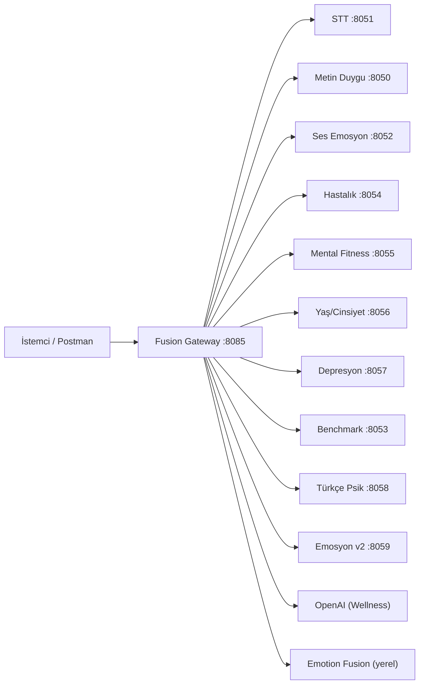

# DiagVoice — AI Analiz API Referansı

> Fusion gateway üzerindeki tüm AI analiz endpointleri. Postman koleksiyonu: `DiagVoice-AI-Analysis.postman_collection.json`

## Hızlı Başlangıç

| Ortam | Base URL |
|-------|----------|
| **Production** | `https://aiapi.diagvoice.com` |

| Kaynak | URL |
|--------|-----|
| Swagger UI | `GET /docs` |
| ReDoc | `GET /redoc` |
| OpenAPI JSON | `GET /openapi.json` |

**Kimlik doğrulama:** Analiz endpointleri için istemci tarafında `Authorization` header **gerekmez**. CORS allowlist uygulanır.

**İçerik türleri:**
- Ses yüklemeleri → `multipart/form-data`
- Metin istekleri → `application/json`

---

## Endpoint Özeti

| # | Method | Path | Açıklama |
|---|--------|------|----------|
| 0 | GET | `/` | Servis bilgisi ve bağımlılıklar |
| 1 | POST | `/analyze-fused` | **Ana endpoint** — tam pipeline |
| 2 | POST | `/togg-analyze` | Ses emosyonu + hastalık (paralel) |
| 3 | POST | `/analyze-emotion-fusion` | Metin+ses 4-sınıf emosyon birleşimi |
| 4 | POST | `/analyze-text-sentiment` | Metin duygu analizi |
| 5 | POST | `/analyze-turkish-psych-signals` | Türkçe psikolojik sinyal sınıflandırıcı |
| 6 | POST | `/analyze-mental-fitness/validate-transcript-meaning` | STT metni anlamlılık doğrulama |
| 7 | POST | `/analyze-voice-to-text` | STT (Whisper) |
| 8 | POST | `/analyze-voice-sentiment` | Ses emosyonu v1 (4 sınıf, WavLM) |
| 8b | POST | `/analyze-emotion-v2` | Emosyon v2 (multimodal stacking) |
| 9 | POST | `/analyze-depression` | Depresyon risk analizi |
| 10 | POST | `/analyze-disease` | WURSS hastalık (healthy/sick) |
| 11 | POST | `/analyze-mental-fitness` | Mental fitness skoru |
| 12 | POST | `/analyze-age-gender` | Yaş & cinsiyet tahmini |
| 13 | POST | `/analyze-text-audio-fusion` | Metin+ses valence füzyonu |
| 14 | POST | `/analyze-benchmark-v2` | İş sağlığı benchmark |
| 15 | POST | `/wellness/companion/chat` | LLM wellness sohbet (metin/ses) |
| 16 | GET | `/admin/diagnostics/models-health` | Admin: model sağlık kontrolü |

---

## Genel Kurallar

### Dosya Alan Adları

| Endpoint | Ses alan adı |
|----------|--------------|
| Çoğu endpoint | `file` |
| `/analyze-text-audio-fusion` | `audio` |
| İç benchmark (`:8053/predict`) | `audio` |
| Wellness ses modu | `file`, `audio` veya `recording` |

### Hata Kodları

| Kod | Anlam |
|-----|-------|
| `400` | Geçersiz payload, zorunlu alan eksik |
| `413` | Dosya boyutu limiti aşıldı (wellness: max 15 MB) |
| `429` | Rate limit (wellness) |
| `500` | Upstream model servisi hatası |
| `502` | Upstream bağlantı hatası |
| `503` | Servis devre dışı (örn. benchmark URL boş) |

### Proxy Davranışı

Fusion, iç mikroservislere proxy yapar. Upstream JSON yanıtı olduğu gibi döner; HTTP status kodu korunur.

---

## 0. GET `/` — Servis Bilgisi

Bağımlı servis URL'lerini, proxy haritasını ve OpenAPI linklerini döndürür.

```bash
curl -X GET "https://aiapi.diagvoice.com/"
```

**Örnek yanıt:**

```json
{
  "message": "Fusion service. POST audio to /analyze-fused.",
  "deps": {
    "voice_to_text": "http://localhost:8051/transcribe",
    "text_to_sentiment": "http://localhost:8050/analyze",
    "voice_to_sentiment": "http://localhost:8052/analyze-audio",
    "disease_service": "http://localhost:8054/analyze-disease",
    "mental_fitness": "http://localhost:8055/analyze-mental",
    "age_gender": "http://localhost:8056/analyze-age-gender",
    "depression_service": "http://localhost:8057/analyze-depression",
    "benchmark_inference": "http://127.0.0.1:8053"
  },
  "openapi": {
    "swagger_ui": "/docs",
    "redoc": "/redoc",
    "openapi_json": "/openapi.json"
  }
}
```

---

## 1. Birleşik Analiz

### POST `/analyze-fused` — Tam Pipeline ⭐

Tüm modelleri tek istekte çalıştırır. **Birincil istemci endpointi.**

| Alan | Tip | Zorunlu | Açıklama |
|------|-----|---------|----------|
| `file` | file | ✅ | Ses dosyası |
| `speech_language` | text | ❌ | `tr` \| `en` \| `ar` (varsayılan: `tr`) |

```bash
curl -X POST "https://aiapi.diagvoice.com/analyze-fused" \
  -F "file=@sample.wav" \
  -F "speech_language=tr"
```

**Örnek yanıt:**

```json
{
  "text": "Bugün kendimi iyi hissediyorum.",
  "text_error": null,
  "text_sentiment": { "sentiment": "POSITIVE", "score": 0.99 },
  "text_sentiment_error": null,
  "audio": {
    "pred_id": 2,
    "pred_label": "happiness",
    "probs": [0.03, 0.08, 0.84, 0.05],
    "intensity": 0.77,
    "duration_sec": 9.8,
    "num_segments": 5
  },
  "audio_error": null,
  "disease": {
    "pred_id": 0,
    "pred_label": "healthy",
    "probs": [0.81, 0.19],
    "labels": { "0": "healthy", "1": "sick" }
  },
  "disease_error": null,
  "mental_fitness": {
    "pred_id": 0,
    "pred_label": "healthy",
    "probs": [0.73, 0.27],
    "mental_fitness_score": 73.0
  },
  "mental_fitness_error": null,
  "age_gender": {
    "gender": { "pred_label": "male", "probs": [0.21, 0.79] },
    "agebin": { "pred_label": "26-35", "probs": [0.05, 0.18, 0.62, 0.15] }
  },
  "age_gender_error": null,
  "depression": {
    "pred_id": 0,
    "pred_label": "saglikli",
    "final_prob_depression": 0.22,
    "risk_level": "dusuk"
  },
  "depression_error": null,
  "benchmark_v2": {
    "mode": "scalar_hgb",
    "positive_class_probability": 0.31,
    "threshold_tuned": 0.5,
    "predicted_class": 0
  },
  "benchmark_v2_error": null,
  "valence_text": 0.91,
  "valence_audio": 0.44,
  "confidence": {
    "text": 0.82,
    "audio": 0.71,
    "disagreement": 0.47,
    "dynamic_fusion": true
  },
  "fused": {
    "valence": 0.88,
    "label": "POSITIVE",
    "w_text": 0.91
  },
  "unified_emotion": {
    "pred_label": "happiness",
    "pred_id": 2,
    "probs": [0.08, 0.07, 0.72, 0.13],
    "agreement": "medium",
    "sources": {
      "text": { "sentiment": "Positive", "score": 0.91 },
      "audio": { "pred_label": "happiness", "intensity": 0.77 }
    }
  }
}
```

**Alan notları:**
- `*_error` alanları alt servis hatalarını taşır (`null` = başarılı)
- `valence_*` değerleri `[0, 1]` aralığında
- `fused.label`: `valence >= 0.5` → `POSITIVE`
- `unified_emotion.probs` sırası: **sadness, fear, happiness, anger**

---

### POST `/togg-analyze` — Ses Emosyonu + Hastalık

Paralel ses emosyonu ve WURSS analizi. STT veya diğer modeller çalışmaz.

| Alan | Tip | Zorunlu |
|------|-----|---------|
| `file` | file | ✅ |

```bash
curl -X POST "https://aiapi.diagvoice.com/togg-analyze" \
  -F "file=@sample.wav"
```

**Örnek yanıt:**

```json
{
  "audio": {
    "pred_label": "happiness",
    "probs": [0.03, 0.08, 0.84, 0.05],
    "intensity": 0.77
  },
  "audio_error": null,
  "disease": {
    "pred_label": "healthy",
    "probs": [0.81, 0.19]
  },
  "disease_error": null
}
```

---

### POST `/analyze-emotion-fusion` — Metin+Ses Emosyon Birleşimi

STT/ses analizi çalıştırmadan mevcut sonuçları 4-sınıf uzayında birleştirir.

**Content-Type:** `application/json`

| Alan | Tip | Zorunlu | Açıklama |
|------|-----|---------|----------|
| `text_sentiment.sentiment` | string | Koşullu* | `Positive` / `Negative` / `Notr` |
| `text_sentiment.score` | float | Koşullu* | `[0, 1]` güven skoru |
| `audio.probs` | float[4] | Koşullu* | sadness, fear, happiness, anger |
| `audio.intensity` | float | ❌ | Ses yoğunluğu |
| `audio.pred_label` | string | ❌ | Baskın ses etiketi |

\* En az `text_sentiment` veya `audio` gerekir.

**Örnek istek (tam birleşim):**

```json
{
  "text_sentiment": {
    "sentiment": "Positive",
    "score": 0.91
  },
  "audio": {
    "probs": [0.55, 0.15, 0.20, 0.10],
    "intensity": 0.6,
    "pred_label": "sadness"
  }
}
```

**Örnek istek (yalnızca metin):**

```json
{
  "text_sentiment": {
    "sentiment": "Negative",
    "score": 0.87
  }
}
```

**Örnek istek (yalnızca ses):**

```json
{
  "audio": {
    "probs": [0.10, 0.05, 0.75, 0.10],
    "intensity": 0.82,
    "pred_label": "happiness",
    "pred_id": 2
  }
}
```

**Örnek yanıt:**

```json
{
  "unified_emotion": {
    "pred_label": "happiness",
    "pred_id": 2,
    "probs": [0.08, 0.07, 0.72, 0.13],
    "agreement": "medium",
    "disagreement": 0.31,
    "w_text": 0.58
  },
  "valence_text": 0.91,
  "valence_audio": 0.35,
  "confidence": {
    "text": 0.82,
    "audio": 0.71,
    "disagreement": 0.56,
    "dynamic_fusion": true
  },
  "fused": {
    "valence": 0.72,
    "label": "POSITIVE",
    "w_text": 0.58
  }
}
```

---

## 2. Metin Analizi

### POST `/analyze-text-sentiment` — Metin Duygu

**Content-Type:** `application/json`

| Alan | Tip | Zorunlu |
|------|-----|---------|
| `text` | string | ✅ |

```bash
curl -X POST "https://aiapi.diagvoice.com/analyze-text-sentiment" \
  -H "Content-Type: application/json" \
  -d '{"text": "Bugün kendimi iyi hissediyorum, enerjim yüksek."}'
```

**Örnek yanıt:**

```json
{
  "sentiment": "POSITIVE",
  "score": 0.99
}
```

---

### POST `/analyze-turkish-psych-signals` — Türkçe Psikolojik Sinyaller

HuggingFace tabanlı Türkçe psik sinyal sınıflandırıcısı. `/analyze-fused` içinde **çalışmaz**.

**Content-Type:** `application/json`

| Alan | Tip | Zorunlu |
|------|-----|---------|
| `text` | string | ✅ |

```json
{
  "text": "Kendimi çok yorgun hissediyorum, hiçbir şey yapmak istemiyorum."
}
```

**Örnek yanıt:**

```json
{
  "text": "Kendimi çok yorgun hissediyorum, hiçbir şey yapmak istemiyorum.",
  "predictions": [
    { "label_id": "3", "score": 0.42, "category_name_tr": "Yorgunluk" },
    { "label_id": "1", "score": 0.28, "category_name_tr": "Üzüntü" }
  ],
  "top_prediction": {
    "label_id": "3",
    "score": 0.42,
    "category_name_tr": "Yorgunluk"
  }
}
```

---

### POST `/analyze-mental-fitness/validate-transcript-meaning` — Transkript Doğrulama

STT çıktısının anlamlı olup olmadığını doğrular.

**Content-Type:** `application/json`

| Alan | Tip | Zorunlu | Açıklama |
|------|-----|---------|----------|
| `text` | string | ✅ | STT metni |
| `language` | string | ✅ | `turkish` \| `english` \| `arabic` vb. |

```json
{
  "text": "Bugün işte çok stresli bir gün geçirdim ama akşam rahatladım.",
  "language": "turkish"
}
```

**Örnek yanıt:**

```json
{
  "meaningful": true,
  "reason": "Metin tutarlı ve anlaşılır.",
  "validation_skipped": false
}
```

---

## 3. Ses Analizi

Tüm ses endpointleri `multipart/form-data` kullanır. Alan adı: **`file`**.

### POST `/analyze-voice-to-text` — STT (Whisper)

| Alan | Tip | Zorunlu | Açıklama |
|------|-----|---------|----------|
| `file` | file | ✅ | Ses dosyası |
| `speech_language` | text | ❌ | `tr` \| `en` \| `ar` |

```bash
curl -X POST "https://aiapi.diagvoice.com/analyze-voice-to-text" \
  -F "file=@sample.wav" \
  -F "speech_language=tr"
```

**Örnek yanıt:**

```json
{
  "text": "Bugün kendimi daha iyi hissediyorum.",
  "language": "tr",
  "language_auto_detected": false
}
```

---

### POST `/analyze-voice-sentiment` — Ses Emosyonu (v1)

4 sınıf: **sadness, fear, happiness, anger** (WavLM multitask; `intensity` döner)

```bash
curl -X POST "https://aiapi.diagvoice.com/analyze-voice-sentiment" \
  -F "file=@sample.wav"
```

**Örnek yanıt:**

```json
{
  "pred_id": 2,
  "pred_label": "happiness",
  "probs": [0.03, 0.08, 0.84, 0.05],
  "intensity": 0.77,
  "duration_sec": 9.8,
  "num_segments": 5,
  "labels": {
    "0": "sadness",
    "1": "fear",
    "2": "happiness",
    "3": "anger"
  }
}
```

---

### POST `/analyze-emotion-v2` — Emosyon v2 (Multimodal Stacking)

Whisper transkript + E5 metin embedding + WavLM + 137 akustik özellik → stacking meta-model.

4 sınıf: **anger, fear, happiness, sadness** (`/analyze-fused` içinde **çalışmaz**; v1'den bağımsız proxy).

| Alan | Tip | Zorunlu | Açıklama |
|------|-----|---------|----------|
| `file` | file | ✅ | Ses dosyası |
| `language` | text | ❌ | `turkish` (varsayılan), `english` veya boş |
| `transcript` | text | ❌ | Verilirse iç Whisper atlanır |

Query: `include_branches=true` — dal olasılıklarını ekler.

```bash
curl -X POST "https://aiapi.diagvoice.com/analyze-emotion-v2" \
  -F "file=@sample.wav" \
  -F "language=turkish"
```

Hazır transkript ile (Whisper atlama):

```bash
curl -X POST "https://aiapi.diagvoice.com/analyze-emotion-v2" \
  -F "file=@sample.wav" \
  -F "transcript=Bugün kendimi oldukça iyi hissediyorum."
```

**Örnek yanıt:**

```json
{
  "prediction": "happiness",
  "confidence": 0.91,
  "probabilities": {
    "anger": 0.02,
    "fear": 0.03,
    "happiness": 0.91,
    "sadness": 0.04
  },
  "transcript": "Bugün kendimi oldukça iyi hissediyorum.",
  "duration_seconds": 18.42,
  "request_id": "uuid",
  "processing_time_ms": 5342.18
}
```

**Not:** GPU önerilir. `EMOTION_V2_URL` boş ise proxy 503 döner.

---

### POST `/analyze-depression` — Depresyon Risk

Ana karar metriği: `final_prob_depression`

```bash
curl -X POST "https://aiapi.diagvoice.com/analyze-depression" \
  -F "file=@sample.wav"
```

**Örnek yanıt:**

```json
{
  "pred_id": 1,
  "pred_label": "depresyon",
  "risk_level": "yuksek",
  "final_prob_depression": 0.78,
  "reliability": "orta",
  "segment_count": 8,
  "threshold": 0.5,
  "segment_probs": [0.71, 0.82, 0.76],
  "labels": {
    "0": "saglikli",
    "1": "depresyon"
  }
}
```

| Alan | Açıklama |
|------|----------|
| `pred_id` | `0` = sağlıklı, `1` = depresyon |
| `risk_level` | `dusuk` \| `orta` \| `yuksek` |
| `final_prob_depression` | Ana karar olasılığı |
| `reliability` | Tahmin güvenilirliği |
| `segment_probs` | Segment bazlı olasılıklar |

---

### POST `/analyze-disease` — WURSS Hastalık

Sağlıklı / hasta (sick) ikili sınıflandırma.

```bash
curl -X POST "https://aiapi.diagvoice.com/analyze-disease" \
  -F "file=@sample.wav"
```

**Örnek yanıt:**

```json
{
  "pred_id": 0,
  "pred_label": "healthy",
  "probs": [0.81, 0.19],
  "labels": {
    "0": "healthy",
    "1": "sick"
  }
}
```

---

### POST `/analyze-mental-fitness` — Mental Fitness

```bash
curl -X POST "https://aiapi.diagvoice.com/analyze-mental-fitness" \
  -F "file=@sample.wav"
```

**Örnek yanıt:**

```json
{
  "pred_id": 0,
  "pred_label": "healthy",
  "probs": [0.73, 0.27],
  "mental_fitness_score": 73.0
}
```

---

### POST `/analyze-age-gender` — Yaş & Cinsiyet

```bash
curl -X POST "https://aiapi.diagvoice.com/analyze-age-gender" \
  -F "file=@sample.wav"
```

**Örnek yanıt:**

```json
{
  "gender": {
    "pred_label": "male",
    "probs": [0.21, 0.79],
    "source": "ready_model"
  },
  "agebin": {
    "pred_label": "26-35",
    "probs": [0.05, 0.18, 0.62, 0.15]
  }
}
```

---

## 4. Füzyon & Benchmark

### POST `/analyze-text-audio-fusion` — Metin+Ses Valence

> ⚠️ Bu endpointte ses alan adı **`audio`** (diğerlerinde `file`).

| Alan | Tip | Zorunlu | Açıklama |
|------|-----|---------|----------|
| `text` | text | ✅ | Girdi metni |
| `audio` | file | ✅ | Ses dosyası |
| `fusion_mode` | text | ❌ | `dynamic` (varsayılan) \| `fixed` |

```bash
curl -X POST "https://aiapi.diagvoice.com/analyze-text-audio-fusion" \
  -F "text=Kendimi biraz yorgun ama iyi hissediyorum." \
  -F "fusion_mode=dynamic" \
  -F "audio=@sample.wav"
```

**Örnek yanıt:**

```json
{
  "text": {
    "sentiment": "POSITIVE",
    "score": 0.93,
    "valence_text": 0.93
  },
  "audio": {
    "valence_audio": 0.44
  },
  "fusion": {
    "mode": "dynamic",
    "w_text": 0.91,
    "valence_fused": 0.88
  }
}
```

---

### POST `/analyze-benchmark-v2` — İş Sağlığı Benchmark

`INFERENCE_API_URL` boşsa `503` döner.

| Alan | Tip | Zorunlu | Açıklama |
|------|-----|---------|----------|
| `file` | file | ✅ | Ses dosyası |
| `transcript` | text | ❌ | Opsiyonel transkript |

```bash
curl -X POST "https://aiapi.diagvoice.com/analyze-benchmark-v2" \
  -F "file=@sample.wav" \
  -F "transcript=Bugün kendimi iyi hissediyorum"
```

**Örnek yanıt:**

```json
{
  "mode": "scalar_hgb",
  "positive_class_probability": 0.31,
  "threshold_tuned": 0.5,
  "predicted_class": 0,
  "class_names_hint": "0=sağlıklı, 1=tanılı risk"
}
```

**UI yorumlama:** `positive_class_probability >= 0.5` → tanılı risk.

---

## 5. Wellness AI (LLM)

### POST `/wellness/companion/chat`

OpenAI tabanlı wellness companion. Sunucuda `OPENAI_API_KEY` gerekir. Rate limit: varsayılan 20 istek/dk/IP.

#### Mod A — Metin

**Content-Type:** `application/json`

```json
{
  "messages": [
    {
      "role": "user",
      "content": "Bugün işte çok stresliydim, kendimi nasıl toparlarım?"
    }
  ],
  "locale": "tr",
  "session_id": "demo-session-001"
}
```

**Çoklu mesaj örneği:**

```json
{
  "messages": [
    { "role": "user", "content": "Merhaba, kendimi yorgun hissediyorum." },
    { "role": "assistant", "content": "Yorgunluk hissetmeniz normal. Biraz dinlenmeyi denediniz mi?" },
    { "role": "user", "content": "Evet ama hâlâ bitkinim." }
  ],
  "locale": "tr"
}
```

**Örnek yanıt:**

```json
{
  "message": "Stresli günler sonrası kendinize zaman ayırmak önemli. Kısa bir yürüyüş veya derin nefes egzersizi deneyebilirsiniz."
}
```

#### Mod B — Ses

**Content-Type:** `multipart/form-data`

| Alan | Tip | Zorunlu | Açıklama |
|------|-----|---------|----------|
| `file` | file | ✅ | Ses kaydı (`audio` veya `recording` da kabul edilir) |
| `messages` | text | ✅ | JSON string olarak mesaj dizisi |
| `locale` | text | ❌ | `tr` \| `en` (varsayılan: `tr`) |
| `session_id` | text | ❌ | Anonim oturum kimliği |

```
file: [ses dosyası]
messages: [{"role":"user","content":"Sesli mesaj gönderiyorum."}]
locale: tr
session_id: voice-session-001
```

**Örnek yanıt:**

```json
{
  "message": "Sesli mesajınızı aldım. Kendinizi yorgun hissetmeniz anlaşılır bir durum...",
  "transcript": "Bugün çok yorgunum ve dinlenmek istiyorum."
}
```

**Hata yanıtları:**

```json
{ "error": "Ses kaydı alanı (file) eksik veya geçersiz." }
```

| Kod | Durum |
|-----|-------|
| 400 | Geçersiz payload |
| 413 | Dosya > 15 MB |
| 429 | Rate limit |
| 502 | Upstream hatası |
| 503 | Wellness devre dışı / OPENAI_API_KEY eksik |

---

## 6. Admin — Model Sağlık Kontrolü

### GET `/admin/diagnostics/models-health`

Tüm iç AI mikroservislerini probe eder.

**Auth:** `Authorization: Bearer <admin_jwt>` (CMS admin rolü gerekir)

```bash
curl -X GET "https://aiapi.diagvoice.com/admin/diagnostics/models-health" \
  -H "Authorization: Bearer <token>"
```

**Örnek yanıt:**

```json
{
  "checked_at": "2026-07-10T10:00:00Z",
  "services": [
    { "id": "text_sentiment", "label": "Metin Duygu", "status": "ok", "latency_ms": 45 },
    { "id": "voice_to_text", "label": "STT", "status": "ok", "latency_ms": 120 },
    { "id": "voice_sentiment", "label": "Ses Emosyonu", "status": "ok", "latency_ms": 89 },
    { "id": "depression", "label": "Depresyon", "status": "ok", "latency_ms": 210 },
    { "id": "benchmark", "label": "Benchmark", "status": "skipped", "latency_ms": null }
  ],
  "summary": { "ok": 8, "warn": 0, "fail": 0, "skipped": 1 }
}
```

---

## 7. İç Mikroservisler (Yerel Geliştirme)

Prod ortamında `127.0.0.1`'e bağlıdır, dışarıdan erişilemez. Docker compose ile yerel test için:

| Port | Servis | Endpoint | Body |
|------|--------|----------|------|
| 8050 | Metin duygu | `POST /analyze` | JSON `{ "text": "..." }` |
| 8050 | Metin+ses füzyon | `POST /analyze_fusion` | multipart: `text`, `audio`, `fusion_mode?` |
| 8051 | STT | `POST /transcribe` | multipart: `file`, `language?` |
| 8052 | Ses emosyonu | `POST /analyze-audio` | multipart: `file` |
| 8053 | Benchmark | `POST /predict` | multipart: `audio`, `transcript?` |
| 8053 | Benchmark health | `GET /health` | — |
| 8054 | Hastalık | `POST /analyze-disease` | multipart: `file` |
| 8055 | Mental fitness | `POST /analyze-mental` | multipart: `file` |
| 8055 | Transkript doğrulama | `POST /validate-transcript-meaning` | JSON `{ "text", "language" }` |
| 8056 | Yaş/cinsiyet | `POST /analyze-age-gender` | multipart: `file` |
| 8057 | Depresyon | `POST /analyze-depression` | multipart: `file` |
| 8058 | Türkçe psik | `POST /analyze` | JSON `{ "text": "..." }` |
| 8058 | Türkçe psik health | `GET /health` | — |
| 8059 | Emosyon v2 | `POST /analyze-audio` | multipart: `file`, `language?`, `transcript?` |
| 8059 | Emosyon v2 health | `GET /health` | — |

---

## Mimari Diyagram



---

## Postman Kullanımı

1. `DiagVoice-AI-Analysis.postman_collection.json` dosyasını Postman'e import edin
2. Collection variable `baseUrl` değerini ortamınıza göre ayarlayın:
   - Prod: `https://aiapi.diagvoice.com`
   - Local: `http://localhost:8085`
3. Ses gerektiren isteklerde `file` / `audio` alanına dosya seçin
4. Admin endpoint için `adminToken` değişkenine CMS JWT girin

---

## İlgili Dosyalar

| Dosya | Açıklama |
|-------|----------|
| `DiagVoice-AI-Analysis.postman_collection.json` | Bu dokümanın Postman koleksiyonu |
| `FUSION_API_REFERENCE.md` | Detaylı teknik referans (frontend eşlemesi dahil) |
| `fusion_service/app.py` | Fusion route tanımları |
| `fusion_service/schemas.py` | Pydantic request/response şemaları |
| `fusion_service/wellness/router.py` | Wellness chat route |

---

*Son güncelleme: 2026-07-10 — `fusion_service/app.py` route'larına göre hazırlanmıştır.*
